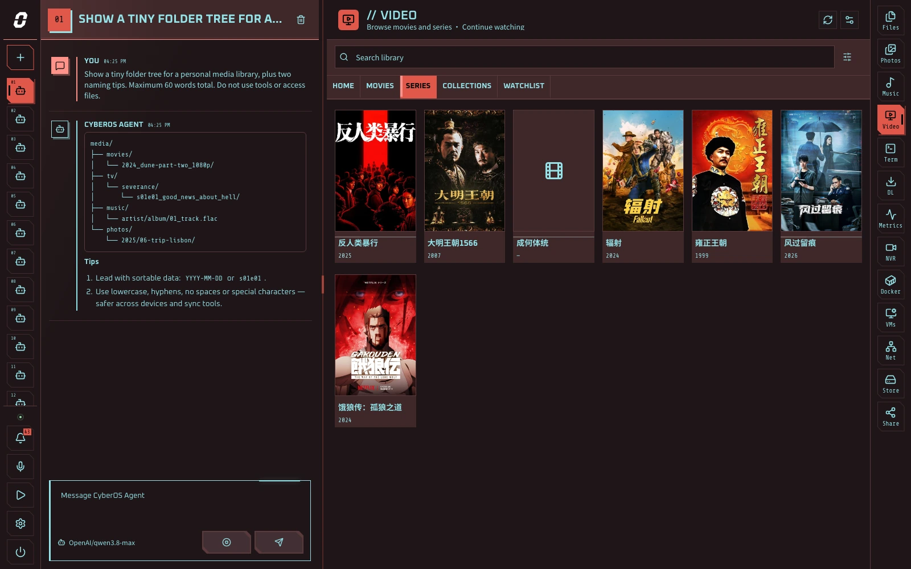
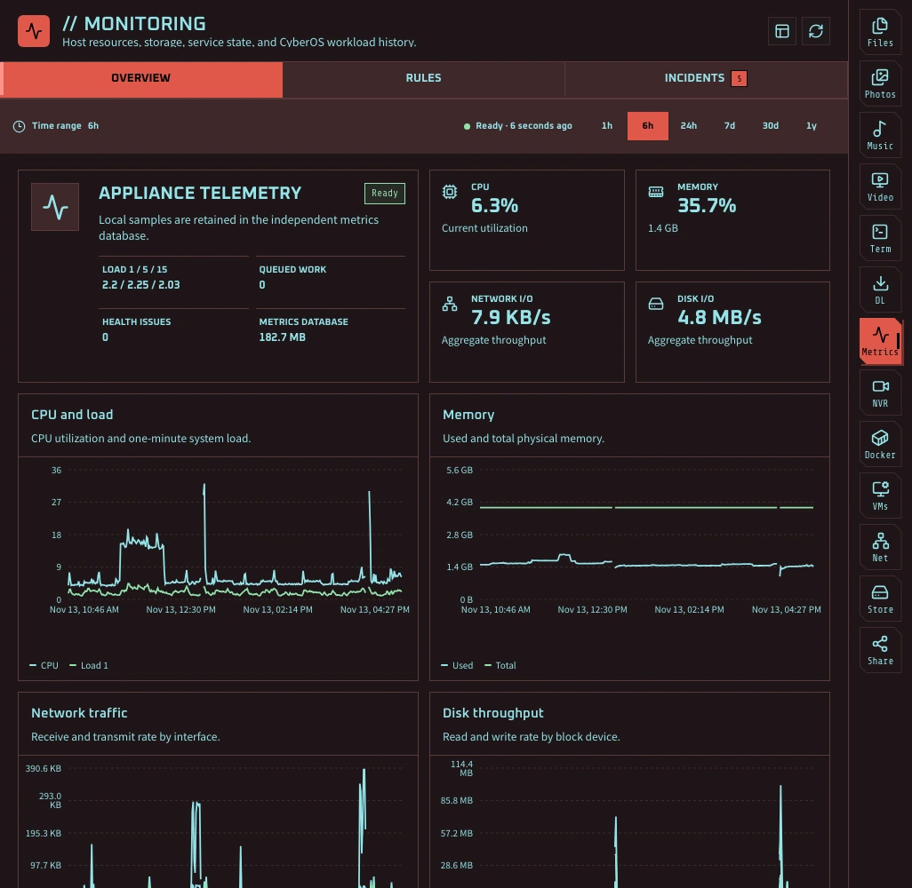
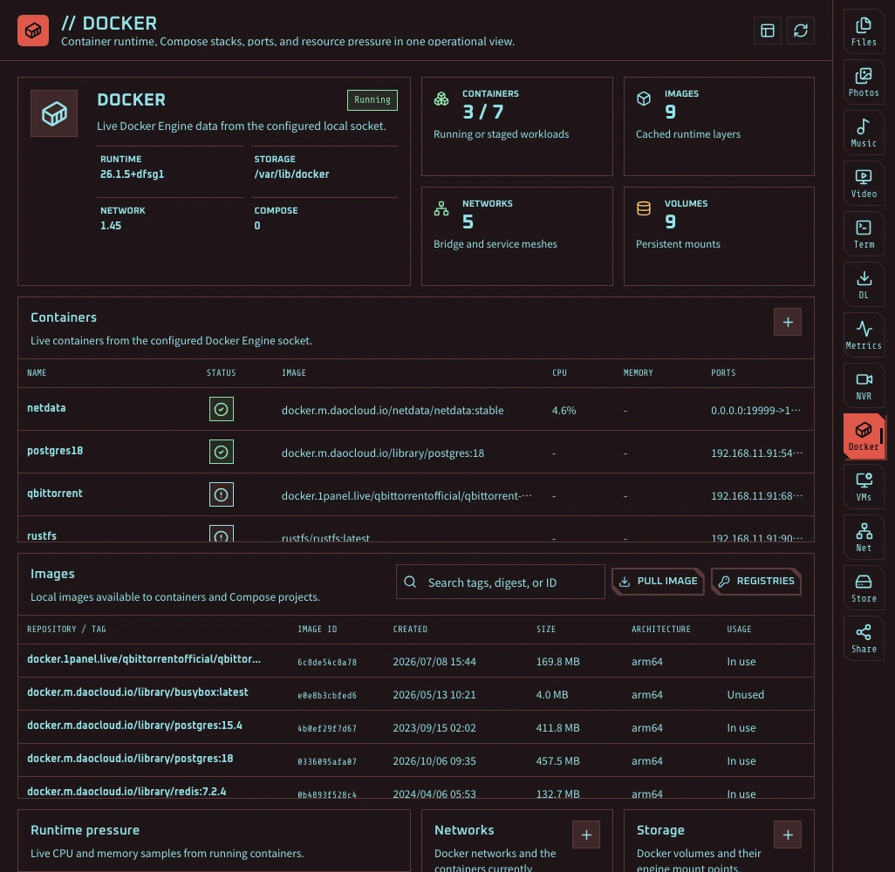

<p align="center">
  <picture>
    <source media="(prefers-color-scheme: dark)" srcset="packages/web/public/cyberos-icon-white.svg">
    
  </picture>
</p>

<h1 align="center">CyberOS</h1>

<p align="center">A personal operating system for the cyber era.</p>

Your files, media, AI assistant, and Linux host in one browser workspace.



- **Files** — Browse storage pools, search content, preview files, and manage transfers.
- **AI** — Persistent conversations, streaming replies, and tools with approval controls.
- **Media** — Photo timelines, music libraries, movies, series, and TV playback.
- **Your machine** — Live metrics, a terminal, containers, virtual machines, storage, and shares.

| Live monitoring | Container management |
| --- | --- |
| [](docs/screenshots/monitoring.webp) | [](docs/screenshots/containers.webp) |

Runs natively on Debian-based Linux (`amd64` and `arm64`) with systemd services and local SQLite storage. Built with React, TypeScript, and Rust.

## Install

From a checkout on a Debian or Raspberry Pi OS host:

```sh
sudo ./packaging/scripts/install.sh
```

See the [installation guide](docs/src/content/docs/operations/deployment.md) for requirements and host setup.

## Develop

Requires Node.js 22.19+ and the pinned Rust 1.95 toolchain.

```sh
npm ci
npm --prefix docs ci
mkdir -p .cyberos/dev-root/data/pool-1
CYBEROS_ENVIRONMENT=development \
CYBEROS_ROOT="$PWD/.cyberos/dev-root" \
npm run dev
```

Open [localhost:5173](http://127.0.0.1:5173). Configure a model provider in **Settings** to enable AI conversations.

[Quick start](docs/src/content/docs/start/quick-start.md) · [Local development](docs/src/content/docs/start/local-development.md) · [Architecture](docs/src/content/docs/architecture/system-overview.md)

Designed for a trusted, single-user network, without multi-user authentication. Read the [security model](docs/src/content/docs/architecture/security.md) before deployment.

Licensed under [Apache-2.0](LICENSE).
